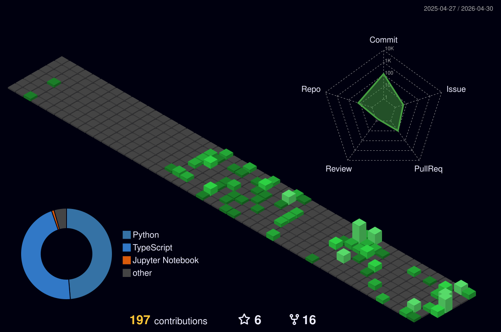

## Hi, I'm Manas 👋

### Software engineer working on AI and ML systems

🎓 MS CS @ USC, graduating May 2027 
💼 AI engineering intern @ Access Ingenuity 
🔬 Research intern @ USC Minerva Labs 
🌱 Previously GSoC '24 @ Liquid Galaxy, SWE intern @ Ombre 
🔍 Open to full-time SWE, AI and ML roles in 2027

[Portfolio](https://manasdalvi.dev) · [LinkedIn](https://linkedin.com/in/manasdalvi) · [X](https://x.com/manas__33) · [Email](mailto:dalvimanas33@gmail.com)

### AI and LLM systems

- **[Reenact](https://github.com/Manas-33/Reenact)** · Regression tests for LLM agents 
  Replays agent runs offline in CI. Caught 17 of 20 seeded regressions. `pip install reenact`

- **[Mulligan](https://github.com/Manas-33/mulligan)** · Undo for AI agents 
  Logs every action, holds risky ones for approval, rewinds whole sessions. 🥉 AI LA Hacks 2026

- **[Prism](https://github.com/Manas-33/prism)** · Code review for a PR's blast radius 
  A GitHub App that checks everything a change can break downstream. 90% citation precision on 160 real PRs.

- **[OttoNote](https://github.com/Manas-33/ottonote)** · Meeting notes that show their sources 
  Every item links to the transcript, and uncertain ones get fact-checked. 98.6% recall, 93.1% precision.

### Infrastructure

- **[Orbit](https://github.com/Manas-33/orbit)** · Distributed job orchestrator in Go 
  gRPC workers, Docker-isolated tasks, DAG workflows and crash recovery.

- **[Moment](https://github.com/Manas-33/moment)** · Long videos to vertical clips 
  Speaker-tracked crops and captions on a Django and Celery job pipeline.

### ML and research

- **[Offhand](https://github.com/Manas-33/offhand)** · Offline assistant on a phone NPU 
  LoRA-tuned Qwen3-0.6B. Tool-call accuracy from 41% to 81%.

- **[Budget-gated speculative decoding](https://github.com/Manas-33/Budget-Gated-Speculative-Decoding)** · Faster LLM code generation 
  A learned gate for early halts. +8.9% throughput on StarCoder2, pass@1 unchanged.

### More projects

- **[Loom](https://github.com/Manas-33/Loom)** · My job-search workspace 
  Checks job boards daily, tailors resumes and pre-fills applications for review.

- **[Memex](https://github.com/Manas-33/memex)** · Chat with your Obsidian notes 
  Hybrid search and an MCP server, on a local model or Gemini.

- **[Hyperfix](https://github.com/Manas-33/Hyperfix)** · A single-focus to-do board 
  AI turns a brain dump into tasks. [Live app](https://hyperfix-app.vercel.app)

- **[LG AI Touristic Explorer](https://github.com/LiquidGalaxyLAB/LG-AI-Touristic-explorer)** · Google Summer of Code '24 
  An AI-narrated city tour on a Liquid Galaxy rig.

### Awards

- 🥇 **1st place**, SoCal Claude Hackathon 2026: [Nucleus](https://devpost.com/software/nucleus-3lgfki), a multi-agent hospital floor console
- 🥈 **Runner-up**, Google DeepMind × GLITCH@UCLA Hackathon 2026: [TakeTwo](https://github.com/Manas-33/taketwo), an AI filmmaking tool
- 🥈 **Runner-up**, Hack the Coast 2026: [Flux](https://github.com/Manas-33/hack-the-coast), a supply-chain operations agent
- 🥉 **3rd place, Cognition track**, AI LA Hacks 2026: [Mulligan](https://github.com/Manas-33/mulligan), undo for AI agents
- 🥈 **Runner-up, Lumio track**, ETHMumbai 2024: [ConsultX](https://github.com/Manas-33/consultX), a decentralized expert-consulting platform

### Tools

<picture>
  <source media="(prefers-color-scheme: dark)" srcset="assets/tech-stack-dark.svg" />
  
</picture>

<!--
### Contributions

  

-->
